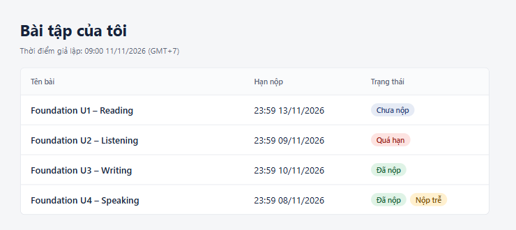
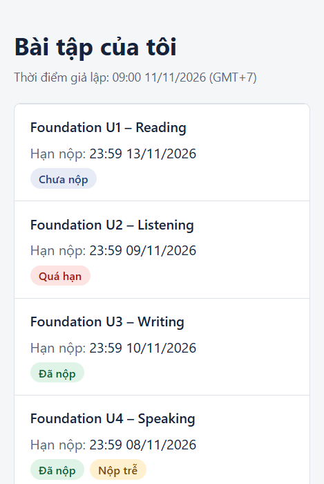

# My Assignments — IELTS Master

A small Next.js (App Router) + TypeScript app that shows the assignment list for the
simulated student **S01**.

Take-home assignment for the Junior Full-Stack Developer position.

| Desktop | Phone |
| --- | --- |
|  |  |

## Running it

```bash
npm install
npm run dev        # http://localhost:3000
```

## Verifying it

```bash
npm test
npm run typecheck
npm run build
```

Actual test output:

```
 ✓ tests/status.test.ts (5 tests) 8ms
 ✓ tests/format.test.ts (2 tests) 6ms
 ✓ tests/status-badge.test.ts (4 tests) 18ms
 ✓ tests/filter.test.ts (3 tests) 27ms

 Test Files  4 passed (4)
      Tests  14 passed (14)
```

`npm run typecheck` reports no errors and `npm run build` compiles successfully.

### Manual check

With `npm run dev` running:

```bash
curl "http://localhost:3000/api/assignments"
curl "http://localhost:3000/api/assignments?studentId=S02"   # spoofing attempt
```

Both calls return **exactly the same payload** — only S01's A01–A04:

```json
{"now":"2026-11-11T02:00:00.000Z","assignments":[
  {"id":"A01","title":"Foundation U1 – Reading",  "status":"pending",  "late":false},
  {"id":"A02","title":"Foundation U2 – Listening","status":"overdue",  "late":false},
  {"id":"A03","title":"Foundation U3 – Writing",  "status":"submitted","late":false},
  {"id":"A04","title":"Foundation U4 – Speaking", "status":"submitted","late":true }
]}
```

*(abridged — the real response also carries `dueAt` and `submittedAt`)*

## Expected result

At the simulated point in time **11/11/2026 09:00 (GMT+7)**:

| ID  | Status displayed        |
| --- | ----------------------- |
| A01 | Chưa nộp                |
| A02 | Quá hạn                 |
| A03 | Đã nộp                  |
| A04 | Đã nộp + Nộp trễ        |
| B01 | absent — belongs to S02 |

Status labels are kept in Vietnamese because the product is for Vietnamese students
and the brief specifies those exact words.

## Status rules

- Submitted → **"Đã nộp"**, plus **"Nộp trễ"** when `submittedAt > dueAt`.
- Not submitted and `now > dueAt` → **"Quá hạn"**; otherwise → **"Chưa nộp"**.
- Handing in exactly at the deadline still counts as on time — the comparison is a
  strict `>`, not `>=`.

## Keeping S02's data out of reach

1. `studentId` comes from `getCurrentStudentId()` on the server (a simulated session).
   It is **never** read from the URL, query string or request body. The `GET` handler
   declares no request parameter at all, so `?studentId=S02` is unreachable from it.
2. Filtering happens in the data layer **before** any status is computed, so record
   B01 never leaves the server in the first place.
3. The API returns a DTO with **no** `studentId` field; the client only ever receives
   data that has already been filtered.
4. Tests assert the response contains no `B01`, `S02` or `studentId`, and that calling
   the endpoint with `?studentId=S02` yields an identical payload.

In a real system, `getCurrentStudentId()` would read an authenticated cookie/session/JWT.
Nothing else in the flow would change.

## Layout

| File                               | Role                                                      |
| ---------------------------------- | --------------------------------------------------------- |
| `src/lib/data.ts`                  | Sample data (carries `studentId`, times as ISO `+07:00`)  |
| `src/lib/status.ts`                | `computeStatus(record, now)` — pure, `now` injected       |
| `src/lib/clock.ts`                 | The fixed simulated clock; never calls `Date.now()`       |
| `src/lib/session.ts`               | Resolves the current student on the server                |
| `src/lib/assignments.ts`           | Filters by student and maps to the DTO                    |
| `src/app/api/assignments/route.ts` | `GET /api/assignments`                                     |
| `src/components/`                  | UI — a table on desktop, stacked cards on mobile          |

Injecting `now` into `computeStatus` instead of calling `Date.now()` inside it is what
makes the status logic testable against a fixed point in time and independent of the
machine's clock.

## Not done

- No real authentication (S01 is simulated), no database, not deployed.
- No filtering or sorting of the list, and no end-to-end UI tests.
